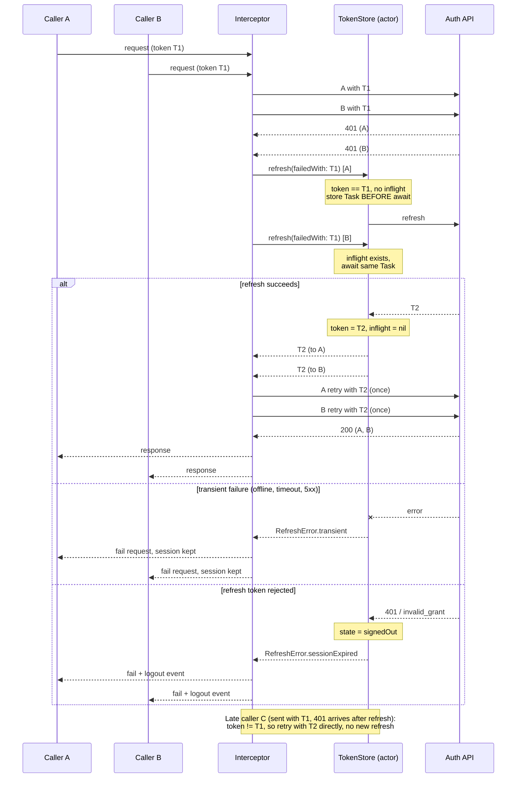

# Networking layer: token refresh

Status: draft (Day 17). Covers token refresh, interceptor chain, observability and mockability. Tests and write-up polish on Day 18.

## Problem

Many requests are in flight with the same access token. The token expires, so they all get a 401 at once. If each one triggers its own refresh, a single-use (rotating) refresh token is spent by the first call and the rest fail, which logs the user out.

## Decisions

- The backend issues the access and refresh tokens. The app stores and sends them, and asks for new ones (Keychain, not UserDefaults).
- The token lives inside a `TokenStore` actor. No static variable: global mutable state leaks between tests.
- One refresh at a time: a single `Task<Token, Error>?` (`inflight`), stored **before** the first `await`. The actor is reentrant, so storing late allows a second refresh.
- Callers that arrive during a refresh await the same task. They are not dropped.
- Dedupe by the token that failed: `refresh(failedWith:)`. If the current token differs from the failed one, someone already refreshed, so the caller retries with the current token and no new refresh starts.
- Each request retries once after a refresh. A second 401 fails the request.
- Refresh failure is a typed error, not a Bool: `transient` (offline, timeout, 5xx: fail the request, keep the session) vs `sessionExpired` (refresh token rejected: sign out).
- After `sessionExpired` the store enters a signed-out state, so later callers fail immediately instead of hammering the server. For `transient`, a short backoff (to be decided in implementation).
- `generated_at` / `expiresAt` (`now + expires_in`) is only a hint for refreshing early. The backend's 401 is authoritative, since the device clock can be wrong.

## Sketch

```swift
enum RefreshError: Error { case transient(Error), sessionExpired }

actor TokenStore {
    private var token: Token
    private var inflight: Task<Token, Error>?

    func refresh(failedWith old: Token) async throws -> Token {
        if token != old { return token }          // someone already refreshed
        if let t = inflight { return try await t.value }
        let t = Task { try await api.refresh() }
        inflight = t                              // store BEFORE awaiting
        defer { inflight = nil }
        token = try await t.value
        return token
    }
}
```

Waiters get the value from `t.value`, not from `token`, so they do not depend on when the first caller resumes.

## Sequence diagram



## Interceptor chain

```
Main:    outer metric → retry/refresh (failure classifier) → auth → logging → inner metric → transport
Refresh: logging → inner metric (tag: refresh) → transport
```

- **Outer metric:** one entry per logical request (final outcome). This is the app success rate: an expected 401 that the refresh fixes invisibly is not a failure.
- **Retry/refresh:** one layer owns "the request failed, so what now?". Retries re-enter below it, so each attempt passes through auth (fresh token), logging and the inner metric.
- **Auth:** attaches the access token.
- **Logging:** below auth, so it logs the real request sent. Redaction is mandatory (see Observability).
- **Inner metric:** one entry per attempt, for backend and network health.
- **Refresh chain is separate.** The refresh call must not pass through auth or the retry/refresh layer: auth would attach the expired token, and a 401 from the refresh endpoint would call `refresh()` again, which awaits the in-flight task that is waiting on itself (deadlock). `TokenStore` receives the refresh client in `init`. It sends the refresh token explicitly.

### Failure classifier

| Failure | Action |
|---|---|
| 401 | `refresh(failedWith:)`, retry once |
| Timeout, offline blip, 5xx, 429 | Retry with backoff + jitter, up to N (honor `Retry-After` on 429) |
| Other 4xx, decoding error | Terminal |
| `sessionExpired` from refresh | Terminal, plus logout event |
| Cancellation | Terminal, not counted as a failure in metrics |

- One shared retry budget per request (one refresh-retry, N transient), so 401 → 503 → 401 cannot loop.
- Idempotency: retry `GET` freely. Retry non-idempotent requests (`POST`, e.g. order tickets) only with an idempotency key, or when the request provably never reached the server.

## Observability

- **Per attempt (logging, inner metric):** method, endpoint, status, size, latency. Headers by allow-list. Bodies are not logged by default; on failure, debug builds only, truncated, fields by allow-list (a regex for emails alone is a weak deny-list). Response body logged on failure only.
- **Per logical request (outer metric):** endpoint template (`/quote`, not the full URL, to keep cardinality low), method, final outcome and error category (offline, timeout, server, auth, decoding, cancelled), final status, attempt count, whether a refresh happened, total latency.
- **Correlation:** a `requestId` generated once per logical request, sent as a header with an `attempt` number on each try, so backend logs line up with app logs. It is the primary key for "find this failed request". Secondary filters: a pseudonymous user id (not raw id or email) and a session id.

## Mockability

- **Seams:** most tests at the `HttpClient` seam (fast, deterministic). A few at `URLProtocol` for the transport adapter itself (it can inject statuses, `URLError` codes, delays; it cannot do real TLS or pinning). Occasional real call to staging as a contract check.
- **Interceptors are transport-independent:** each takes a request and a `next` closure, so a test passes a stub `next`. Only the last link, the `URLSession` adapter, is concrete.

```swift
protocol Interceptor {
    func intercept(_ req: URLRequest,
                   next: (URLRequest) async throws -> HTTPResponse) async throws -> HTTPResponse
}
```

- **Race test:** main fake is stateful (401 for T1, 200 for T2). Refresh fake holds a continuation (a gate) released only after all N callers are waiting; otherwise tasks may run one after another and never overlap. Launch N callers with a `TaskGroup`. Assert: refresh called exactly once, all N succeed, main fake saw each request exactly twice.
- **Late-caller test:** a 401 with T1 arriving after the refresh finished causes zero extra refreshes.

## Open

- Backoff policy and N for transient retries: decide during implementation.
- Failure paths beyond the three in the diagram: find while implementing.
