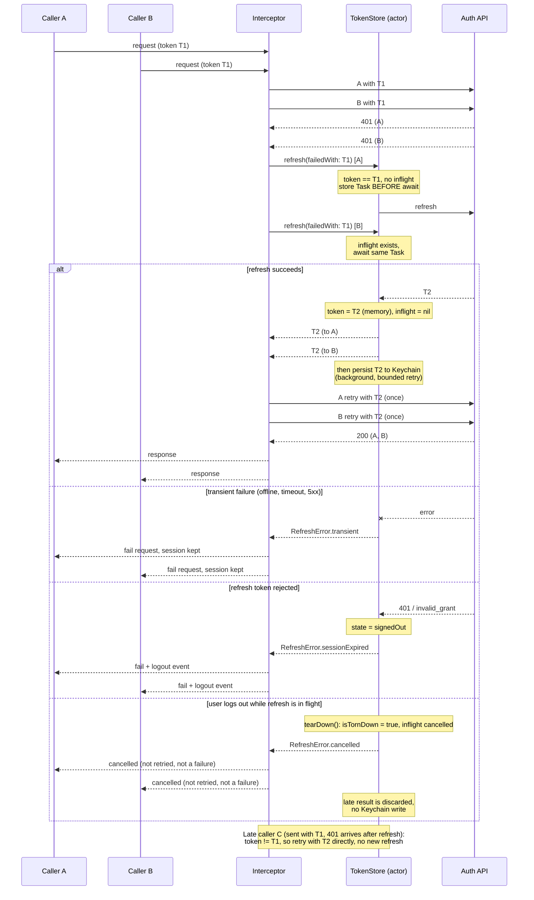

# Networking layer design

Status: draft (Days 17-18). Covers token refresh, interceptor chain, observability, mockability, app suspension, Keychain failure and session scope.

## Problem

Many requests are in flight with the same access token. The token expires, so they all get a 401 at once. If each one triggers its own refresh, a single-use (rotating) refresh token is spent by the first call and the rest fail, which logs the user out.

## Decisions

- The backend issues the access and refresh tokens. The app stores and sends them, and asks for new ones (Keychain, not UserDefaults).
- The token lives inside a `TokenStore` actor. No static variable: global mutable state leaks between tests.
- One refresh at a time: a single `Task<Token, Error>?` (`inflight`), stored **before** the first `await`. The actor is reentrant, so storing late allows a second refresh.
- Callers that arrive during a refresh await the same task. They are not dropped.
- Dedupe by the token that failed: `refresh(failedWith:)`. If the current token differs from the failed one, someone already refreshed, so the caller retries with the current token and no new refresh starts.
- Each request retries once after a refresh. A second 401 fails the request.
- Refresh failure is a typed error, not a Bool: `transient` (offline, timeout, 5xx: fail the request, keep the session) vs `sessionExpired` (refresh token rejected: sign out).
- After `sessionExpired` the store enters a signed-out state, so later callers fail immediately instead of hammering the server. For `transient`, a short backoff (to be decided in implementation).
- `generated_at` / `expiresAt` (`now + expires_in`) is only a hint for refreshing early. The backend's 401 is authoritative, since the device clock can be wrong.

## Sketch

```swift
enum RefreshError: Error { case transient(Error), sessionExpired, cancelled }

actor TokenStore {
    private var token: Token
    private var inflight: Task<Token, Error>?
    private var isTornDown = false
    private var signedOut = false
    private let refreshClient: RefreshClient      // separate chain, injected
    private let keychain: TokenPersisting         // key includes the user id

    func refresh(failedWith old: Token) async throws -> Token {
        if isTornDown || signedOut { throw RefreshError.cancelled }
        if token != old { return token }          // someone already refreshed
        if let t = inflight { return try await t.value }
        // refreshClient maps errors: network -> .transient, explicit rejection -> .sessionExpired
        let t = Task { try await refreshClient.refresh() }
        inflight = t                              // store BEFORE awaiting
        defer { inflight = nil }
        do {
            let new = try await t.value
            guard !isTornDown else { throw RefreshError.cancelled }
            token = new                           // memory first
            persistInBackground(new)              // detached, bounded retry, never blocks the return
            return new
        } catch RefreshError.sessionExpired {
            signedOut = true
            throw RefreshError.sessionExpired
        }
    }

    func tearDown() { isTornDown = true; inflight?.cancel() }
}
```

Waiters get the value from `t.value`, not from `token`, so they do not depend on when the first caller resumes. `persistInBackground` checks `isTornDown` before every Keychain write.

## Sequence diagram



## Interceptor chain

```
Main:    outer metric → retry/refresh (failure classifier) → auth → logging → inner metric → transport
Refresh: logging → inner metric (tag: refresh) → transport
```

- **Outer metric:** one entry per logical request (final outcome). This is the app success rate: an expected 401 that the refresh fixes invisibly is not a failure.
- **Retry/refresh:** one layer owns "the request failed, so what now?". Retries re-enter below it, so each attempt passes through auth (fresh token), logging and the inner metric.
- **Auth:** attaches the access token.
- **Logging:** below auth, so it logs the real request sent. Redaction is mandatory (see Observability).
- **Inner metric:** one entry per attempt, for backend and network health.
- **Refresh chain is separate.** The refresh call must not pass through auth or the retry/refresh layer: auth would attach the expired token, and a 401 from the refresh endpoint would call `refresh()` again, which awaits the in-flight task that is waiting on itself (deadlock). `TokenStore` receives the refresh client in `init`. It sends the refresh token explicitly.

### Failure classifier

| Failure | Action |
|---|---|
| 401 | `refresh(failedWith:)`, retry once |
| Timeout, offline blip, 5xx, 429 | Retry with backoff + jitter, up to N (honor `Retry-After` on 429) |
| Other 4xx, decoding error | Terminal |
| Refresh rejected by the server (explicit `invalid_grant` / 401 from the refresh endpoint) | `sessionExpired`: terminal, plus logout event. Only an explicit server rejection means the session is dead |
| Refresh fails with a network error (`networkConnectionLost`, timeout, offline, 5xx) | `transient`: fail the request, keep the session, never log out |
| Cancellation | Terminal, not counted as a failure in metrics |

Notes:
- The two "Refresh ..." rows describe the refresh chain's result, not a main request. The main request that triggered the refresh then fails with the mapped error.
- A 401 on the retry after a successful refresh is terminal: the request fails and does not refresh again.

- One shared retry budget per request (one refresh-retry, N transient), so 401 → 503 → 401 cannot loop.
- Idempotency: retry `GET` freely. Retry non-idempotent requests (`POST`, e.g. order tickets) only with an idempotency key, or when the request provably never reached the server.

## Observability

- **Per attempt (logging, inner metric):** method, endpoint, status, size, latency. Headers by allow-list. Bodies are not logged by default; on failure, debug builds only, truncated, fields by allow-list (a regex for emails alone is a weak deny-list). Response body logged on failure only.
- **Per logical request (outer metric):** endpoint template (`/quote`, not the full URL, to keep cardinality low), method, final outcome and error category (offline, timeout, server, auth, decoding, cancelled), final status, attempt count, whether a refresh happened, total latency.
- **Correlation:** a `requestId` generated once per logical request, sent as a header with an `attempt` number on each try, so backend logs line up with app logs. It is the primary key for "find this failed request". Secondary filters: a pseudonymous user id (not raw id or email) and a session id.

## Mockability

- **Seams:** most tests at the `HttpClient` seam (fast, deterministic). A few at `URLProtocol` for the transport adapter itself (it can inject statuses, `URLError` codes, delays; it cannot do real TLS or pinning). Occasional real call to staging as a contract check.
- **Interceptors are transport-independent:** each takes a request and a `next` closure, so a test passes a stub `next`. Only the last link, the `URLSession` adapter, is concrete.

```swift
protocol Interceptor {
    func intercept(_ req: URLRequest,
                   next: (URLRequest) async throws -> HTTPResponse) async throws -> HTTPResponse
}
```

- **Race test:** main fake is stateful (401 for T1, 200 for T2). Refresh fake holds a continuation (a gate) released only after all N callers are waiting; otherwise tasks may run one after another and never overlap. Launch N callers with a `TaskGroup`. Assert: refresh called exactly once, all N succeed, main fake saw each request exactly twice.
- **Late-caller test:** a 401 with T1 arriving after the refresh finished causes zero extra refreshes.

## App suspension during refresh

Scenario: a screen fires 3 requests with an expired token, refresh starts, and iOS suspends the app.

- Suspension freezes tasks; they resume with the app. But a foreground `URLSession` request often does not survive: on resume it can fail with `networkConnectionLost` (-1005) or a timeout. The design handles both outcomes.
- **Lost refresh response (the real bug):** the server may have rotated the token while the response never reached the app. The app still holds the spent refresh token, so the next refresh is rejected and a naive classifier logs the user out although nothing was wrong.
- Mitigations:
  - Wrap the refresh call and the Keychain write in `beginBackgroundTask` so iOS lets them finish.
  - Memory first: set the token in memory, release the waiters, then persist to the Keychain (see Keychain write failure).
  - Network errors during refresh are `transient`, never `sessionExpired` (see classifier).
  - Ask the backend for a grace window (previous refresh token valid for a few seconds after rotation) or an idempotent refresh. This is the real fix and needs backend cooperation.
  - Keychain accessibility: see Keychain write failure.

## Keychain write failure

The in-memory token is the source of truth; the Keychain only persists it for the next launch (restored on launch).

- Order after a successful refresh: set memory, release the waiters, then persist.
- A Keychain failure never fails or blocks requests.
- Retry a transient Keychain error once or twice, then stop.
- No user-facing prompts: the user cannot act on it usefully.
- On final failure, record the error code in a metric or log (never the token) and carry on.
- If the app is killed before persisting, the next launch restores the old, spent refresh token, the refresh is rejected, and the user sees the login screen. Accepted.
- Keep the Keychain-failure rate as a metric: it is the only signal that users are being logged out for this reason.
- Keychain items use `afterFirstUnlock`, so a refresh finishing while the device is locked can still read and write the token. This prevents the most common cause of a write failure.

## Session scope (logout during refresh)

Scenario: A and B get a 401, A's refresh starts, and the user logs out (or logs out and logs in as someone else) before it finishes. The late result must never reach the new session.

- **App scope** (lives for the whole app run): `baseURL`, logging and metrics config, `URLSession` configuration, and the unauthenticated chain used by login, sign-up and the refresh call.
- **User scope** (created at login, torn down at logout): `TokenStore`, the main interceptor chain, and the API clients built on them.
- A stale refresh can only touch its own `TokenStore`, so object identity replaces a generation counter.
- **Keychain is shared storage**, so a dead store could still clobber the new session. Two rules close this:
  - The Keychain key includes the user id (`token.<userId>`), so an old store can only write to its own slot.
  - Teardown cancels `inflight` and sets `isTornDown = true`. The store checks the flag before any Keychain write and throws `cancelled` if it is set.
- Teardown must be explicit. Dropping the reference is not enough: a running `Task` keeps its captured `TokenStore` alive.
- Waiters (B) get `cancelled`: not retried, not shown to the user, not counted as a failure in the metric.
- Anything holding the old stack (view models, repositories) is rebuilt at login. Nothing at app scope may cache a user-scoped client.
- The backend revokes the refresh token on logout, so a dropped refresh result is useless anyway.
- Logs and metrics never contain the raw user id (see Observability); the Keychain key is the only place it appears.

## Open

- Backend grace window for the previous refresh token: needs a decision with the backend team.
- Backoff policy and N for transient retries: decide during implementation.
- Covered by pressure test: app suspension during refresh, logout during refresh, Keychain write failure. Further failure paths: find while implementing.
